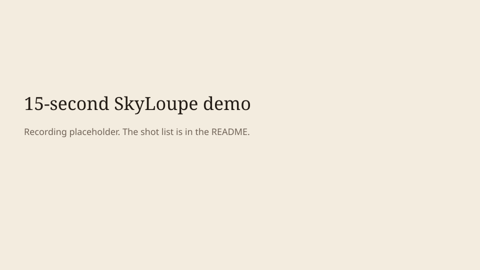

# SkyLoupe

Annotate a live React page, preview the tokens, and hand Codex a source location instead of a guessed selector.

[中文说明](docs/zh-CN.md)

## 15-second demo



1. **0–4s.** In Chrome, press **Annotate**. Move across the pricing cards and the revenue chart. The **Q3 Revenue** bar gets its own outline.
2. **4–9s.** Click the **Pro** card. Pull the radius from `8px` to `20px`, set the accent to emerald, hold **Hold to compare**, type `Make Pro stand out`, and press **Send to Codex**.
3. **9–15s.** The capsule reads `Codex editing src/components/PricingCard.tsx... Done (5.2s)`. The dev server hot-reloads the token. The same `http://127.0.0.1:5173/` URL is what you open in the ChatGPT desktop browser, where the native controls take over. That last check is in [docs/m5-checklist.md](docs/m5-checklist.md).

```bash
pnpm install
pnpm --filter skyloupe build
pnpm exec skyloupe demo
```

`pnpm exec skyloupe demo --offline` replays the recorded edit and HMR loop with no Codex CLI and no network, then exits.

## What it is

| Package | Role |
| --- | --- |
| `@skyloupe/core` | Types, preview rollback, and canvas hit-test guard. No runtime dependencies. |
| `@skyloupe/react` | `AnnotationContainer`, `Annotatable`, `useAnnotationControls`, `AnnotatableCanvas`. |
| `@skyloupe/vite` | Dev-only `data-skyloupe-source` and `.skyloupe/session.json` injection. |
| `@skyloupe/devtools` | Polyfill and shadow-DOM capsule when the native API is absent. |
| `skyloupe` | `init`, `bridge`, `mcp`, `doctor`, `demo`. |

`@skyloupe/core` stays under 2 KB gzip. Core plus the React production entry stay under 4 KB gzip.

## Compared with agentation

This is the comparison from the project plan, not a review of agentation's current source.

|  | SkyLoupe | agentation |
| --- | --- | --- |
| License | MIT | PolyForm |
| `document.oai.annotation` | The supported surface | Not the target API |
| `registerControls` | Live token sliders with preview and rollback | No |
| `registerSurface` | Canvas objects such as the Q3 bar | No |
| Codex | `codex app-server` on `127.0.0.1`, or copy the Markdown bundle | No local bridge |

## Commands

```bash
pnpm exec skyloupe init
pnpm exec skyloupe bridge
pnpm exec skyloupe mcp
pnpm exec skyloupe doctor ./src
pnpm exec skyloupe demo
pnpm exec skyloupe demo --offline
```

`bridge` listens on `127.0.0.1` only, checks `Host` and `Origin`, and requires the pairing token in `X-SkyLoupe-Token`.

## Develop this repo

Node 20 or newer. pnpm 10.33.4.

```bash
pnpm lint
pnpm typecheck
pnpm test
pnpm build
pnpm check:size
```

The spec table is [docs/spec-compliance.md](docs/spec-compliance.md). Choices the plan does not spell out are in [docs/decisions.md](docs/decisions.md).
